<picture><source media="(max-width: 481px)" srcset="assets/hero-narrow.svg"><source media="(min-width: 482px) and (max-width: 602px), (min-width: 768px) and (max-width: 890px)" srcset="assets/hero-small.svg"><source media="(min-width: 603px) and (max-width: 767px), (min-width: 891px) and (max-width: 1133px)" srcset="assets/hero-medium.svg"><source media="(prefers-color-scheme: dark)" srcset="assets/hero-dark.svg"></picture>

<a href="mailto:nikhil.k.pawar.06@gmail.com"><picture><source media="(prefers-color-scheme: dark)" srcset="assets/btn-email-dark.svg"></picture></a>&nbsp;&nbsp;<a href="https://www.linkedin.com/in/nikhil-pawar0609"><picture><source media="(prefers-color-scheme: dark)" srcset="assets/btn-linkedin-dark.svg"></picture></a>

<picture><source media="(max-width: 481px)" srcset="assets/figures-narrow.svg"><source media="(min-width: 482px) and (max-width: 602px), (min-width: 768px) and (max-width: 890px)" srcset="assets/figures-small.svg"><source media="(min-width: 603px) and (max-width: 767px), (min-width: 891px) and (max-width: 1133px)" srcset="assets/figures-medium.svg"><source media="(prefers-color-scheme: dark)" srcset="assets/figures-dark.svg"></picture>

### Projects

<a href="https://github.com/aimsotrash/homelab-infra"><picture><source media="(max-width: 1133px)" srcset="assets/blank.svg"><source media="(prefers-color-scheme: dark)" srcset="assets/card-homelab-infra-dark.svg"></picture></a><a href="https://github.com/aimsotrash/self-healing-infra"><picture><source media="(max-width: 1133px)" srcset="assets/blank.svg"><source media="(prefers-color-scheme: dark)" srcset="assets/card-self-healing-infra-dark.svg"></picture></a><a href="https://github.com/aimsotrash/homelab-infra"><picture><source media="(min-width: 1134px)" srcset="assets/blank.svg"><source media="(min-width: 603px) and (max-width: 767px), (min-width: 891px) and (max-width: 1133px)" srcset="assets/project-homelab-infra-medium.svg"><source media="(min-width: 482px) and (max-width: 602px), (min-width: 768px) and (max-width: 890px)" srcset="assets/project-homelab-infra-small.svg"></picture></a><a href="https://github.com/aimsotrash/self-healing-infra"><picture><source media="(min-width: 1134px)" srcset="assets/blank.svg"><source media="(min-width: 603px) and (max-width: 767px), (min-width: 891px) and (max-width: 1133px)" srcset="assets/project-self-healing-infra-medium.svg"><source media="(min-width: 482px) and (max-width: 602px), (min-width: 768px) and (max-width: 890px)" srcset="assets/project-self-healing-infra-small.svg"></picture></a>

<a href="https://github.com/aimsotrash/streamlora"><picture><source media="(max-width: 1133px)" srcset="assets/blank.svg"><source media="(prefers-color-scheme: dark)" srcset="assets/card-streamlora-dark.svg"></picture></a><a href="https://github.com/aimsotrash/Cipherlink"><picture><source media="(max-width: 1133px)" srcset="assets/blank.svg"><source media="(prefers-color-scheme: dark)" srcset="assets/card-cipherlink-dark.svg"></picture></a><a href="https://github.com/aimsotrash/streamlora"><picture><source media="(min-width: 1134px)" srcset="assets/blank.svg"><source media="(min-width: 603px) and (max-width: 767px), (min-width: 891px) and (max-width: 1133px)" srcset="assets/project-streamlora-medium.svg"><source media="(min-width: 482px) and (max-width: 602px), (min-width: 768px) and (max-width: 890px)" srcset="assets/project-streamlora-small.svg"></picture></a><a href="https://github.com/aimsotrash/Cipherlink"><picture><source media="(min-width: 1134px)" srcset="assets/blank.svg"><source media="(min-width: 603px) and (max-width: 767px), (min-width: 891px) and (max-width: 1133px)" srcset="assets/project-cipherlink-medium.svg"><source media="(min-width: 482px) and (max-width: 602px), (min-width: 768px) and (max-width: 890px)" srcset="assets/project-cipherlink-small.svg"></picture></a>

<a href="https://github.com/aimsotrash/Daily-Brief"><picture><source media="(max-width: 1133px)" srcset="assets/blank.svg"><source media="(prefers-color-scheme: dark)" srcset="assets/card-daily-brief-dark.svg"></picture></a><a href="https://github.com/aimsotrash/Engram"><picture><source media="(max-width: 1133px)" srcset="assets/blank.svg"><source media="(prefers-color-scheme: dark)" srcset="assets/card-engram-dark.svg"></picture></a><a href="https://github.com/aimsotrash/Daily-Brief"><picture><source media="(min-width: 1134px)" srcset="assets/blank.svg"><source media="(min-width: 603px) and (max-width: 767px), (min-width: 891px) and (max-width: 1133px)" srcset="assets/project-daily-brief-medium.svg"><source media="(min-width: 482px) and (max-width: 602px), (min-width: 768px) and (max-width: 890px)" srcset="assets/project-daily-brief-small.svg"></picture></a><a href="https://github.com/aimsotrash/Engram"><picture><source media="(min-width: 1134px)" srcset="assets/blank.svg"><source media="(min-width: 603px) and (max-width: 767px), (min-width: 891px) and (max-width: 1133px)" srcset="assets/project-engram-medium.svg"><source media="(min-width: 482px) and (max-width: 602px), (min-width: 768px) and (max-width: 890px)" srcset="assets/project-engram-small.svg"></picture></a>

<a href="https://github.com/shravanibnikam/rhea-period-tracker"><picture><source media="(max-width: 1133px)" srcset="assets/blank.svg"><source media="(prefers-color-scheme: dark)" srcset="assets/card-rhea-dark.svg"></picture></a><a href="https://github.com/Vatsalya2003/ghostline"><picture><source media="(max-width: 1133px)" srcset="assets/blank.svg"><source media="(prefers-color-scheme: dark)" srcset="assets/card-ghostline-dark.svg"></picture></a><a href="https://github.com/shravanibnikam/rhea-period-tracker"><picture><source media="(min-width: 1134px)" srcset="assets/blank.svg"><source media="(min-width: 603px) and (max-width: 767px), (min-width: 891px) and (max-width: 1133px)" srcset="assets/project-rhea-medium.svg"><source media="(min-width: 482px) and (max-width: 602px), (min-width: 768px) and (max-width: 890px)" srcset="assets/project-rhea-small.svg"></picture></a><a href="https://github.com/Vatsalya2003/ghostline"><picture><source media="(min-width: 1134px)" srcset="assets/blank.svg"><source media="(min-width: 603px) and (max-width: 767px), (min-width: 891px) and (max-width: 1133px)" srcset="assets/project-ghostline-medium.svg"><source media="(min-width: 482px) and (max-width: 602px), (min-width: 768px) and (max-width: 890px)" srcset="assets/project-ghostline-small.svg"></picture></a>

<a href="https://github.com/linkml/linkml/pull/4093"><picture><source media="(max-width: 481px)" srcset="assets/also-linkml-narrow.svg"><source media="(min-width: 482px) and (max-width: 602px), (min-width: 768px) and (max-width: 890px)" srcset="assets/also-linkml-small.svg"><source media="(min-width: 603px) and (max-width: 767px), (min-width: 891px) and (max-width: 1133px)" srcset="assets/also-linkml-medium.svg"><source media="(prefers-color-scheme: dark)" srcset="assets/also-linkml-dark.svg"></picture></a>

Live demos: <a href="https://dory-md-fork.vercel.app">Engram</a>&nbsp;· <a href="https://shravanibnikam.github.io/rhea-period-tracker/">Rhea</a>&nbsp;· <a href="https://ghostline-eta.vercel.app">ghostline</a>

### Experience

<picture><source media="(max-width: 481px)" srcset="assets/experience-narrow.svg"><source media="(min-width: 482px) and (max-width: 602px), (min-width: 768px) and (max-width: 890px)" srcset="assets/experience-small.svg"><source media="(min-width: 603px) and (max-width: 767px), (min-width: 891px) and (max-width: 1133px)" srcset="assets/experience-medium.svg"><source media="(prefers-color-scheme: dark)" srcset="assets/experience-dark.svg"></picture>

At HP I administered the AWS account behind its commercial device-telemetry platform.

- The account ingested telemetry from millions of enterprise devices through Kinesis into a petabyte-scale, five-tier lake on S3, Hive/RDS and Redshift. I provisioned EMR jobs and infrastructure for new sources, as often as daily during device launches.
- Automated GDPR erasure with Airflow-orchestrated Python, replacing manual ingestion pauses and hand-restarted deletion jobs. Turnaround went from up to a month to 48 hours, inside the two-week compliance window.
- Managed the account's infrastructure as code with Terraform and Terragrunt, including moving Terraform state out of a relinquished AWS account.
- Built Azure DevOps pipelines that deploy Terraform, Lambda and EMR jobs to AWS from a git commit.
- Wrote IAM roles and policies from scratch, including cross-account data-sharing roles, and owned the remediation of security findings.
- Shared the production on-call rotation, triaging job and pipeline failures through CloudWatch alarms and PagerDuty.

### Education

<picture><source media="(max-width: 481px)" srcset="assets/education-narrow.svg"><source media="(min-width: 482px) and (max-width: 602px), (min-width: 768px) and (max-width: 890px)" srcset="assets/education-small.svg"><source media="(min-width: 603px) and (max-width: 767px), (min-width: 891px) and (max-width: 1133px)" srcset="assets/education-medium.svg"><source media="(prefers-color-scheme: dark)" srcset="assets/education-dark.svg"></picture>

### Stack

<picture><source media="(max-width: 481px)" srcset="assets/stack-narrow.svg"><source media="(min-width: 482px) and (max-width: 602px), (min-width: 768px) and (max-width: 890px)" srcset="assets/stack-small.svg"><source media="(min-width: 603px) and (max-width: 767px), (min-width: 891px) and (max-width: 1133px)" srcset="assets/stack-medium.svg"><source media="(prefers-color-scheme: dark)" srcset="assets/stack-dark.svg"></picture>

Seattle, WA&nbsp;· <a href="mailto:nikhil.k.pawar.06@gmail.com">nikhil.k.pawar.06@gmail.com</a>&nbsp;· <a href="https://www.linkedin.com/in/nikhil-pawar0609">linkedin.com/in/nikhil-pawar0609</a>
